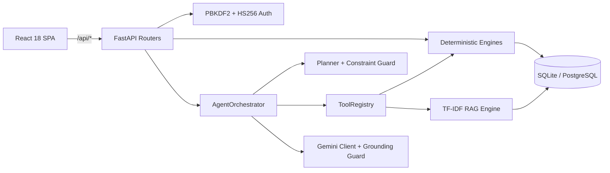

# GovPath AI — Technical System Architecture

## 1. System Architecture Overview

GovPath AI separates deterministic domain computation, transactional relational persistence, and bounded multi-agent orchestration cleanly:

- **Routers (`backend/app/routers/`):**
  - `auth.py`: `/api/auth/register`, `/login`, `/demo`, `/me`.
  - `profile.py`: `/api/profile`, `/api/dashboard`, `/api/notifications*`.
  - `exams.py`: `/api/exams*`, `/api/knowledge-graph*`.
  - `assessments.py`: `/api/assessments*`, `/api/practice*`.
  - `intelligence.py`: `/api/readiness`, `/api/gap-analysis`, `/api/knowledge-transfer`, `/api/diagnosis`, `/api/retention`, `/api/analytics`.
  - `planning.py`: `/api/pathways`, `/api/study-plan*`, `/api/simulator`.
  - `counsellor.py`: `/api/counsellor/*`, `/api/rag/*`, `/api/system/status`.

---

## 2. Agent Orchestration & Shared State

Implemented across `backend/app/agents/`:

- **State Object (`OrchestrationState` in `schemas.py`):** Tracks `query`, `structured_intent`, `action_constraints`, `selected_agents`, `execution_iteration`, `tool_calls_used`, `llm_calls_used`, `estimated_tokens_used`, `agent_outputs`, `retrieved_evidence`, `tool_execution_records`, `missing_evidence`, `limitations`, `errors`, `fallback_used`, `llm_error`, and `proposed_action`.
- **Conditional Execution Loop (`orchestrator.py`):**
  - Enforces hard bounds (`ORCHESTRATOR_MAX_ITERATIONS=4`, `ORCHESTRATOR_MAX_TOOL_CALLS=24`, `ORCHESTRATOR_MAX_LLM_CALLS=6`, `ORCHESTRATOR_TIMEOUT_SECONDS=45.0`).
  - Before invoking each agent, enforces:
    - `action_constraint_guard`: Skips `StudyOptimizationAgent` when `investigation_only=True` or `plan_generation_allowed=False` or `plan_preview_allowed=False`.
    - `prerequisite_guard`: Skips `PerformanceDiagnosisAgent` when `assessments_completed == 0`; skips `KnowledgeTransferAgent`/`StudyOptimizationAgent` when `primary_examination` is not supported in `ExamIntelligenceAgent`'s catalogue.
    - `duplicate_agent_guard` and `tool_budget_guard`.
  - After Iteration 1, calls `evaluate_evidence_and_plan_followup` (`Evidence Evaluator`) which inspects `StudentAnalysisAgent` findings (e.g., `assessments_completed > 0` paired with `overdue_count > 0`, `declining_items`, `accuracy < 65%`, or `StudyOptimizationAgent` needing `PathwayPlanningAgent` workload simulation) and conditionally schedules Iteration 2 agents.

---

## 3. Intent Planner & Prohibition Guardrails (`planner.py`)

- **Clause-Scoped Action Constraints (`extract_action_constraints`):** Splits user input on sentence/contrast delimiters (`[.;!?\n]`, `but`, `however`, `yet`, `instead`), detects negations paired with plan nouns or `activate`/`apply`/`save`/`persist`/`modify`/`change`/`edit`/`alter`, masks negated spans into `affirmative_query`, and records simultaneous prohibition + plan request conflicts (`conflicting_plan_request`).
- **Dual-Mode Planning (`plan_user_query`):**
  1. **LLM Structured Mode:** Sends system rules, valid exam IDs, and registered tools to Gemini JSON mode (`StructuredPlan` schema) when configured; normalizes via `_normalize_plan` so LLM outputs cannot bypass deterministic prohibitions or inject unapproved agents/tools.
  2. **Deterministic Fallback Mode (`build_fallback_plan`):** Activates automatically when LLM is unconfigured or fails, selecting minimal agents and tools cleanly across transfer, feasibility, investigation, next-assessment recommendation, progress monitoring, diagnosis, retention, and study-plan review/generation.

---

## 4. Six Specialized Agents (`specialized.py`)

| Agent | Responsibility | Core Tools Used |
|---|---|---|
| `StudentAnalysisAgent` | Retrieves profile, availability, weighted readiness, full evidence/missing lists, retention status, progress, read-only existing study tasks, and multi-candidate next assessment recommendations | `get_aspirant_profile`, `get_preparation_constraints`, `get_student_readiness`, `get_competency_evidence`, `get_retention_status`, `get_preparation_progress`, `get_existing_study_tasks`, `recommend_next_assessment` |
| `ExamIntelligenceAgent` | Verifies supported exams, stages, competency weightage, official portals, and sanitized RAG passages | `get_exam_catalogue`, `get_exam_structure`, `get_exam_syllabus`, `get_official_exam_sources`, `search_exam_documents` |
| `PerformanceDiagnosisAgent` | Analyzes answer-level errors and weak competencies; reads `StudentAnalysisAgent` retention trends from shared state to avoid misclassifying `Improving` competencies (`>= 70%`) with 1 old error as weak | `diagnose_assessment_errors`, `get_weak_competencies` |
| `KnowledgeTransferAgent` | Computes graph structural overlap vs verified evidence transferability and multi-exam comparisons | `calculate_transferability`, `compare_exams` |
| `PathwayPlanningAgent` | Ranks exam pathways and evaluates available study hours vs estimated gap-closure workload (`Time-Constrained` vs `Balanced` vs `Comfortable Cushion`) | `get_pathway_recommendations`, `simulate_preparation_constraints` |
| `StudyOptimizationAgent` | Generates non-persisted adaptive weekly study plan previews when authorized | `get_existing_study_tasks`, `generate_study_plan_preview` |

---

## 5. Tool Registry & Security Controls (`tool_registry.py`)

- Maintains an explicit allowlist of 23 registered tools, each bound to a Pydantic input schema.
- Enforces: cross-user rejection (`user_id` mismatch blocked), workflow action constraint enforcement (`generate_study_plan_preview` blocked if `plan_generation_allowed=False`), tool budget tracking, duplicate call caching (`cache_key = tool_name:canonical_args`), per-tool timeout (`ThreadPoolExecutor`), RAG prompt-injection sanitization (`sanitize_untrusted_text`), and structured `ToolExecutionRecord` logging.

---

## 6. LLM Integration & Deterministic Fallback (`llm_client.py`)

- Active external provider is Google Gemini (`https://generativelanguage.googleapis.com/v1beta/models/{model}:generateContent`). OpenAI runtime calls are disabled.
- Redacts `GEMINI_API_KEY` / query keys from all logged/returned error strings.
- Returns structured `LLMCallResult` distinguishing HTTP `429`/`503`, `Timeout`, malformed JSON, schema validation errors, and empty candidates.
- During synthesis (`orchestrator.py`), `_verify_numeric_grounding` rejects any LLM rewrite introducing percentage numbers not present in deterministic tool outputs.

---

## 7. Data Models, Engines & Lifecycles

- **Database Schema (`models.py`):** `User` → `StudentProfile`, `AssessmentAttempt` → `AttemptAnswer`, `CompetencyEvidence`, `StudyPlan` → `StudyTask`, `SavedQuestion`, `Notification`, `ChatSession` → `ChatMessage`, `Exam` ↔ `ExamCompetencyRequirement` ↔ `Competency` ↔ `Subject`, `Question`, `RAGDocument` → `RAGChunk`. SQLite connections enforce `PRAGMA foreign_keys=ON`.
- **Competency & Readiness Model (`readiness.py`):** Weights observations by source (`mock_test=1.35`, `diagnostic=1.15`, `subject_test=1.10`, `topic_quiz=1.00`, `revision=0.85`, `study_task=0.60`), exponential recency decay (`exp(-days_old / 30)`), and distinct coverage (`evidence_count > 0`); confidence scales as `1 - exp(-0.48 * evidence_count)`.
- **Retention & Progress (`retention.py`, `diagnosis.py`):** Classifies trends (`Improving >= +5`, `Declining <= -5`, `Stable`, `Single Observation`, `Needs Baseline`) and assigns spaced review intervals (`4`, `7`, `12` days), flagging `Declining` items as `Revision Overdue`.
- **RAG (`rag.py`):** Chunks uploaded/seeded syllabus docs into overlapping word chunks, scores via TF-IDF cosine similarity (`scikit-learn`), and wraps passages with untrusted-reference disclosures.
- **Study Plan Lifecycle (`planning.py`, `counsellor.py`):** Counsellor previews remain in-memory (`persist=False`); only explicit confirmation (`POST /api/counsellor/apply-proposal` or `POST /api/study-plan/generate` with `confirm_replace=True` when an active plan exists) deactivates prior active plans and persists tasks.
